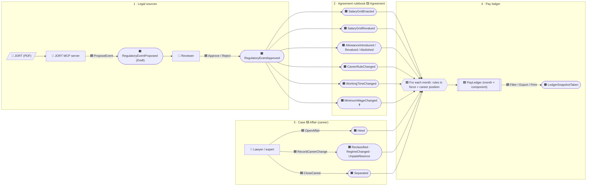

# Sprint 05: event storming — "rebuild one salary over many years"

This is a working document for the brainstorm. Items marked **❓** are hotspots: questions for the domain expert
(Lazhar Lataoui). The model in §4 is a proposal and will change with the answers.

## 1. The big picture (timeline)

Read left to right. The legend follows event-storming practice: 🟦 command, 🟧 domain event, 🟨 aggregate,
🟪 policy (a reaction to an event), 🟩 read model, 🩷 external system, 👤 actor.



## 2. Domain events

### 2.1 Legal sources (the "where")

| Event | Data | Notes |
|---|---|---|
| `LegalSourceRegistered` | kind (agreement, rider, ministerial order, decree), number, title, JORT issue number and date, file, pages | One per PDF. Every rule event cites one. |
| `RegulatoryEventProposed` | event payload, citation (source, page, article), proposer (MCP or user), confidence | Draft status. Not used in calculations. |
| `RegulatoryEventApproved` | event id, reviewer, timestamp | From now on it is used in calculations, and it is immutable. |
| `RegulatoryEventRejected` | event id, reason | |
| `RegulatoryEventRetracted` | event id, reason, replaced by | Corrects an approved event without editing it. |

### 2.2 Agreement rulebook (the "what", each with `EffectiveFrom` and a `Citation`)

| Event | Data | Effect on the rules in force |
|---|---|---|
| `AgreementSigned` | agreement, sector, signing date | Starts the agreement's history. |
| `GridLineDeclared` | code (e.g. `WORKERS`), name, unit (hourly / monthly), category codes | A stable line of grids (fixes C2 and C3). |
| `SalaryGridEnacted` | grid line, categories × degrees amounts (in millimes), `PayUnit`, work regime | Replaces the whole grid of that line. |
| `SalaryGridRevalued` | grid line, rule (percentage for all / per category band / fixed amount), rounding, **published amounts (optional, override each cell)** | A new grid, derived from the one in force. |
| `AllowanceIntroduced` | allowance code (e.g. `PRESENCE`, `TRANSPORT`), name, `Basis` (fixed / percentage of base / per hour / per day), amount or rate per regime / category | Adds a component. |
| `AllowanceRevalued` | code, new amount or rate (published), optional percentage | Changes a component. |
| `AllowanceAbolished` | code | Removes a component. |
| `CareerRuleChanged` | months spent in each degree, per grid line | Fixes C4. |
| `WorkingTimeChanged` | regime, legal hours per week and per month | Used to convert hourly rates. ❓ 48 h → 208 h; 40 h → 173.33 h? |
| `MinimumWageChanged` ❓ | SMIG / SMAG per regime | Floor for the base salary, if the agreement or the law applies it. |

### 2.3 Case / career (the "who")

| Event | Data |
|---|---|
| `Hired` | date, grid line, category code, degree, regime, seniority taken over from before (optional) |
| `Reclassified` | date, new category (and degree) |
| `DegreeOverridden` | date, degree (when a document proves a degree other than the computed one) |
| `RegimeChanged` | date, regime |
| `UnpaidAbsence` | period (no salary, and no seniority ❓) |
| `Separated` | date of the layoff (end of the reconstruction) |

## 3. Policies and read models

- 🟪 **Rulebook fold.** `PayRules = fold(approved rule events, ordered by EffectiveFrom, then kind, then sequence)`. A later
  `SalaryGridEnacted` supersedes the earlier one. A retroactive order simply sorts earlier.
- 🟪 **Career progression.** Each month, the degree advances when the time spent in the current degree reaches the current
  career rule. The state is cumulative, so the degree never goes down (C4).
- 🟪 **Valuation.** For each month and each component: rate = rules(month) × position(month); amount = rate × quantity
  (hours or prorated days) → `MonthlyAmount`, rounded per component.
- 🟪 **Published-amount check.** When a revaluation gives both a percentage and amounts, the computed and published
  values are compared, and any difference greater than 0 millimes is shown as a warning.
- 🟩 **PayLedger.** One row per month and component: period, component, unit, rate, quantity, proration, monthly amount,
  the cause (the event ids that set the value), the citation, and any issue. Views:
  - **Detailed**: every month.
  - **Changes only**: a row only where a value changes, which is the "log" in the user's words.
  - **Concise for print**: runs of identical months collapsed into "from–to" ranges, with the JORT citations as footnotes.
- 🟩 **LedgerSnapshot.** A frozen copy of a ledger as exported or printed, with the event ids and a hash (P6).

## 4. Proposed domain model (sketch, C#)

```csharp
// Kernel
readonly record struct Money(long Millimes);                       // TND, 3 decimals, no float
enum PayUnit { Monthly, Hourly, Daily }
enum RoundingRule { HalfUp, Truncate }
sealed record WorkRegime(string Code, decimal HoursPerMonth);      // e.g. "H48" 208, "H40" 173.33 ❓
sealed record Citation(LegalSourceId Source, int Page, string? Article);

// Rulebook (aggregate: Agreement with its approved event stream)
abstract record RuleEvent(RuleEventId Id, DateOnly EffectiveFrom, Citation Source, int Sequence);
sealed record SalaryGridEnacted(..., GridLineCode Line, PayUnit Unit, IReadOnlyDictionary<(CategoryCode, int Degree), Money> Cells) : RuleEvent;
sealed record SalaryGridRevalued(..., GridLineCode Line, RevaluationRule Rule, RoundingRule Rounding, IReadOnlyDictionary<(CategoryCode, int), Money>? Published) : RuleEvent;
sealed record AllowanceIntroduced(..., AllowanceCode Code, AllowanceBasis Basis, ...) : RuleEvent;
// ... AllowanceRevalued, AllowanceAbolished, CareerRuleChanged, WorkingTimeChanged

sealed class Rulebook                                               // pure fold, no I/O
{
    public static Rulebook From(IEnumerable<RuleEvent> approved);
    public PayRules At(DateOnly day);                               // grids, allowances, career rule, regimes in force
    public IReadOnlyList<RuleChange> ChangesBetween(DateOnly from, DateOnly to);
}

// Career (aggregate: Affair with its career events)
sealed class Career { public static Career From(IEnumerable<CareerEvent> events); public Position At(DateOnly day, Rulebook rules); }

// Ledger (domain service + read model)
sealed class PayLedgerBuilder(IProrationPolicy proration, IDegreeProgressionPolicy progression)
{
    public PayLedger Build(Career career, Rulebook rules);
}
sealed record LedgerEntry(YearMonth Month, ComponentCode Component, PayUnit Unit, Money? Rate, decimal Quantity,
                          decimal Proration, Money? MonthlyAmount, IReadOnlyList<RuleEventId> Causes, LedgerIssue Issue);
```

Design choices:

- **Pure domain.** `Rulebook`, `Career` and `PayLedgerBuilder` do no I/O and depend on no clock, so they are fully
  covered by unit tests. Each test is a scenario: given these events, when the ledger is built, then these entries.
- **Event-sourced in spirit, not in infrastructure.** The events are stored as append-only rows (a type discriminator and
  a JSON payload with a schema version). The fold runs in memory: 40 years × 12 months × about 15 components is around
  7,200 entries, which is trivial. There is no event-store product or message bus.
- **Open/closed.** Adding a new kind of factor means adding a `RuleEvent` subtype and the code that applies it; nothing
  existing is rewritten. Allowance bases are a strategy (`IAllowanceBasis`).
- **Two clocks.** `EffectiveFrom` (when a rule applies) and `PublishedOn` / `ApprovedAt` (when it became known). A snapshot
  records "as known on", so a report can be produced again later (P6).

## 5. Hotspots ❓ (questions for the domain expert)

1. Which components should be in the claim (base, presence prime, transport, meal basket, seniority, output, …)? Which
   ones does the textile agreement have?
2. What are the two columns in the 2024 order (76.491 / 68.693)? Two regimes, or two groups of categories?
3. Partial months: calendar days or a 30-day base?
4. The seniority prime: what rule does it follow (a percentage of the base for each bracket of years)?
5. Degree progression: months spent in each degree, from the date of hire or from the last reclassification? Is the
   last degree a ceiling?
6. Does the legal minimum wage (SMIG) apply as a floor?
7. Hours per month for each regime (208 / 173.33)?
8. Unpaid absence: does it suspend seniority?
9. Should the ledger also compare **owed and paid** (the salary the employer actually paid, from the payslips) to compute
   the arrears claimed? The legacy schema had an `ActualMonthSalary` entity.
10. The MCP server: only local PDFs, or should it also download from the IORT site? Which client will run it (Claude
    Desktop or Claude Code)?
