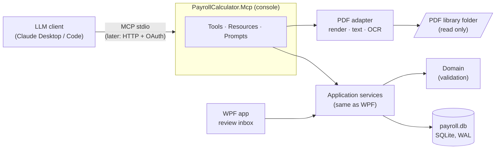

## Sprint 06: JORT MCP server and connector

> **Deferred.** For the first release, the light seed loop (sprint 07, 07.13) replaces this sprint: an LLM with vision
> writes the seed JSON, `seed verify` checks it, and a person reviews the diff. This plan stays for when the library grows
> or other people enter texts. See `../07_Reference_Data_Seed/approaches_compared.md`.

1. **Context.** Every rule that sets a salary is published in the JORT as a PDF: agreements, riders, ministerial orders.
   Sprint 05 models these rules as dated, cited events that a person approves, but the user still has to type them in.
   The Arabic PDFs have no usable text layer. `pdftotext` returns the digits but garbled words (see
   `05_Regulatory_Events_Pay_Ledger/design_review.md` §1).
2. **Objective.** Build an **MCP server** that lets an LLM client (Claude Desktop, Claude Code, later claude.ai) do three
   things:
   - go through the whole PDF library and read each page;
   - create the **agreements**, their **grid lines** and **salary grids**, the **revaluations** and the
     **primes and allowances**, all as **Draft** events, each citing its source;
   - check what it extracted against the domain rules.

   Then **package it as a connector** that installs in one step. A person still approves every draft in the app.
3. **Depends on.** Sprint 05, deliverable 1: the rule events, the Draft and Approved statuses, the event store and the
   application services (05.4, 05.11 and 05.14). Sub-sprints 06.1 to 06.4 (the catalogue and page reading) do not
   depend on it and can start earlier.
4. **Out of scope.** Approving events from the LLM, which is never allowed. Career events (an affair is not taken from
   the JORT). Downloading from the IORT web site: 06.13 decides on that.

---

## Architecture

- **The MCP server is a driving adapter, the same kind as the WPF app.** It calls the same Application services, so
  the Domain validates everything an LLM proposes. No SQL or business rule is written twice.
- **It writes only Draft events, and it has no approve tool.** Approval happens in the app, by a signed-in user, with
  the page image shown next to the extracted values (sprint 05.14 and 06.10).
- **The app and the server share the database.** SQLite in WAL mode allows one writer and many readers, so the app can
  stay open while the server writes drafts. The app refreshes its inbox when the drafts change.
- **Projects:**
  - `src/PayrollCalculator.Mcp`: the host, built on the official C# SDK, `ModelContextProtocol`.
  - `src/PayrollCalculator.Infrastructure/Pdf`: PDF rendering with PDFium (`PDFtoImage` or `Docnet.Core`, both MIT),
    optional OCR with Tesseract `ara+fra`, digit extraction from the text layer.
  - `tests/PayrollCalculator.Mcp.Tests`: tests through an in-memory MCP client.

## The MCP surface

### Resources (read only)

| URI | Content |
|---|---|
| `jort://library` | Index of the library: documents, SHA-256, pages, extraction state of each page |
| `jort://documents/{id}` | Metadata: file, pages, detected language, legal source if known |
| `jort://documents/{id}/pages/{n}.png` | Page image (default 200 dpi) |
| `payroll://agreements` | Agreements, their grid lines and their category codes |
| `payroll://agreements/{id}/rules?at=YYYY-MM-DD` | Rules in force on a date (grids and allowances): lets the LLM see what is already known and avoid proposing it twice |
| `payroll://drafts` | Drafts waiting for review, by source |

### Tools

| Group | Tool | Annotation | Purpose |
|---|---|---|---|
| Catalogue | `scan_library` | read-only | Index the PDF folder (new, changed or duplicate files, by hash) |
| | `document_info` | read-only | Pages, language, quality of the text layer |
| Reading | `render_page` | read-only | Page image for the vision model |
| | `page_text` | read-only | Text layer (useful for French texts; for Arabic, digits only) |
| | `find_amounts` | read-only | Numbers on a page with their positions; normalizes Arabic-Indic digits and the decimal comma, and returns millimes |
| | `ocr_page` | read-only | Tesseract `ara+fra`, optional, when the vision model is not enough |
| | `mark_page` | write (state) | Page state: unread, no rule, extracted, needs a human |
| Lookups | `list_agreements`, `rules_in_force`, `list_drafts` | read-only | Context before proposing |
| Proposals (Draft) | `propose_legal_source` | write | Kind, number, JORT issue and date, file, pages |
| | `propose_agreement` | write | New agreement (sector, name, signing date) |
| | `propose_grid_line` | write | Grid line: code, name, unit (hourly or monthly), category codes |
| | `begin_grid` → `add_grid_rows` → `finish_grid` | write | A large grid built in chunks (an LLM answer has a size limit); `finish_grid` validates it and creates the `SalaryGridEnacted` draft |
| | `propose_revaluation` | write | Percentage (for all or per band), rounding, published amounts |
| | `propose_allowance` | write | Introduce, revalue or abolish a prime or allowance |
| | `propose_career_rule`, `propose_working_time` | write | Time spent in each degree; hours per regime |
| | `withdraw_draft` | write | Withdraw its own draft before review |
| Checks | `check_grid` | read-only | Complete; amounts increase with the degree and the category (a decrease marks the cell "to check" with a reason, never corrected silently; sprint 07 G2); plausible for the unit (hourly vs monthly) |
| | `compare_published_vs_computed` | read-only | Percentage against published amounts, with the gap in millimes |

Every write tool:
- takes an `idempotency_key`, so the same call made twice creates only one draft;
- requires a `citation` (document, page, article);
- returns the domain errors as **codes plus an English explanation**, so the LLM can correct itself.

### Prompts

| Prompt | Purpose |
|---|---|
| `extract_document` | Step-by-step workflow for one PDF: identify the text (kind, number, JORT issue), find its articles, then propose a source, grids, revaluations and allowances, then check each one |
| `extract_library` | Loop over the documents not yet extracted, one document at a time, with a progress report |
| `review_hints` | Summary of the drafts, for the human reviewer |

## Security and safety

| Risk | Rule |
|---|---|
| A misread value reaches a court filing | Drafts only; human approval in the app; `check_grid` and the published-vs-computed check |
| **Prompt injection through a PDF** (text in a document that gives instructions) | The content of documents is returned as data, framed as such; the server has no tool that can approve, delete approved data or reach the network |
| Reading files outside the library | One root folder set in the configuration; paths are resolved and checked against it; no symbolic links; size limit per file |
| Changes that cannot be traced | Audit log of every tool call (time, tool, arguments without content, result); each draft records `proposer = mcp:<client>` |
| Remote exposure (later connector over HTTP) | Off by default; OAuth 2.1 as the MCP specification requires; bound to localhost unless configured otherwise; read-only mode available |

## Sub-sprints

All of them are to do and written test first.

| # | Sub-sprint | Content | First tests |
|---|---|---|---|
| 06.0 | **Decisions** | Client(s) to support; connector format (06.12); OCR or vision only; IORT download or not; the library folder | — |
| 06.1 | **MCP host skeleton** | `PayrollCalculator.Mcp`, stdio transport, DI shared with the app (`AddApplication`, `AddInfrastructure`), configuration (database path, library root), logs to stderr only (stdout carries the protocol) | An in-memory client lists the tools; nothing but MCP messages on stdout |
| 06.2 | **Library catalogue** | `scan_library`, `document_info`, `jort://library`; SHA-256 deduplication; page states in a `LibraryPages` table (EF migration) | A duplicate file is detected; a changed file is re-indexed; a path outside the root is refused |
| 06.3 | **Page rendering** | `render_page`, `jort://documents/{id}/pages/{n}.png`; dpi limits; cache | Renders page 1 of the 2024 order; refuses page 0 and pages after the last |
| 06.4 | **Text and amounts** | `page_text`, `find_amounts` (Arabic-Indic digits, decimal comma, millimes), detection of an unusable text layer | Finds 7.930 / 8.445 / 9.036 in `arrete2024-1383arabe-35.pdf`; flags the Arabic text layer as unusable |
| 06.5 | **Optional OCR** | `ocr_page` with Tesseract `ara+fra` (language data installed separately); the tool is hidden when Tesseract is missing | Skipped in CI when Tesseract is absent; on a sample page it finds the word "الأجر" |
| 06.6 | **Lookups and the rules in force** | `list_agreements`, `rules_in_force`, `list_drafts` and their resources, through the Application services | Returns what sprint 05 stored, and only that |
| 06.7 | **Proposals: sources, agreements, grid lines** | `propose_legal_source`, `propose_agreement`, `propose_grid_line`; citation required; idempotency | Same key twice gives one draft; a missing citation gives a coded error |
| 06.8 | **Proposals: grids in chunks** | `begin_grid` / `add_grid_rows` / `finish_grid`; a session is kept until `finish_grid` or a timeout | A 40 × 12 grid sent in 4 chunks gives one draft; an unknown category code is reported with its row |
| 06.9 | **Proposals: revaluations, allowances, career, working time** | The remaining proposal tools; `withdraw_draft` | A staged order (2024, 2025, 2026) gives 3 drafts with the same citation |
| 06.10 | **Checks** | `check_grid`, `compare_published_vs_computed` | A misread digit that breaks the increase from one degree to the next is caught; the gap 81.462 / 81.463 is reported as 1 millime |
| 06.11 | **Review inbox in the app** | List of drafts by source; the page image next to the values; approve, reject or correct and approve; refresh when the drafts change | An approved draft reaches the ledger; a rejected one never does |
| 06.12 | **Connector packaging** | v1: an MCP bundle (`.mcpb`) for Claude Desktop, with a manifest asking for the database path and the library folder; a `.mcp.json` snippet for Claude Code and an `opencode.json` snippet for OpenCode (sprint 07, G9). v2 (optional): Streamable HTTP with OAuth for a remote connector | The manifest validates; the server starts from the bundle on a clean machine |
| 06.13 | **IORT (optional, after 06.0)** | Download a text from its JORT reference into the library; allow-list for the IORT domain only | Decided in 06.0 |
| 06.14 | **Prompts and the extraction workflow** | `extract_document`, `extract_library`, `review_hints` | The prompts list their tools; dry run on one document |
| 06.15 | **Evaluation on the sample library** | Values checked by hand for the sample PDFs (`data/jort/files`); a script runs the extraction and scores it (precision and recall per cell, citations correct) | Score recorded here; the target is set in 06.0 |
| 06.16 | **Documentation and closing** | `dotnet/README.md` (MCP section), `CLAUDE.md`, an installation guide in Arabic for the user | — |

## Delivery order

1. **06.0 – 06.6**: a read-only server, usable as soon as it exists to read the PDFs with an LLM.
2. **06.7 – 06.11**: proposals and the review inbox. This needs sprint 05, deliverable 1.
3. **06.12 – 06.16**: the connector, the prompts and the evaluation.

## Definition of done

- From Claude Desktop, with the connector installed, the user can say «اقرأ كل الاتفاقيات» ("read all the agreements"),
  and the inbox in the app then holds cited drafts for the sample library.
- No value reaches the ledger without approval. No tool approves.
- The server reads nothing outside the library folder, and its audit log records every call.
- The evaluation score on the sample library is recorded.
- Warnings are errors, and all tests pass.

## Decisions (filled in during 06.0)

| # | Question | Answer |
|---|---|---|
| 1 | Clients to support (Claude Desktop, Claude Code, claude.ai remote) | |
| 2 | Connector: `.mcpb` bundle first, remote HTTP later? | |
| 3 | Vision model only, or Tesseract OCR as well? | |
| 4 | Download from IORT, or local PDFs only? | |
| 5 | Location of the PDF library | |
| 6 | Target score for the evaluation | |
