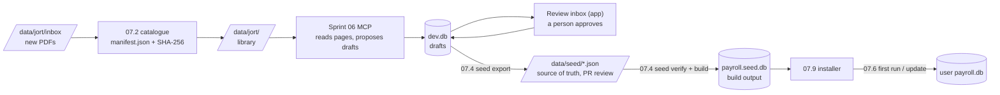

## Sprint 07: reference data, seed database and fast reset

1. **Context.** The product ships with **all the sectoral agreements already entered**: their legal texts, grid lines,
   salary grids, revaluations, primes and allowances. A user opens an affair, picks a sector and a hiring date, and the
   ledger is right with no typing. The data in the app today is a **sample** (`payroll.sqlite`, a few test tables).
   It can be thrown away.
2. **Objective.**
   - A **pipeline** from the JORT PDFs to a **seed database** built from files kept in the repository, and later
     shipped in the installer.
   - A **fast cycle** for development and tests: wipe, rebuild from the seed, run, in one command.
   - A **safe update path**: when new texts are published after release, users get them without losing their affairs.
3. **Depends on.**
   - Sprint 05: the event store, Draft and Approved statuses and snapshots (done), and the application services (05.14).
   - Not on sprint 06 any more: the full MCP server is deferred. The **light seed loop** (07.13) replaces it for the first
     release (see `approaches_compared.md`).
   - 07.0 to 07.5 can start now. The rest follows 05.14 and 06.
4. **Out of scope.** Downloading texts from the IORT site (06.13). Arrears (owed minus paid): sprint 08.

---

## Insights from Gemini

Gemini's review of the ingestion pipeline (OCR → LLM/MCP → database), weighed against what sprints 05 and 06 already plan.

| # | Insight | Worth it? | Where it goes |
|---|---|---|---|
| G1 | Extract grids as **JSON structured cell by cell**, not free text, because the JORT table lines are badly printed and OCR merges columns | **Already planned**: the MCP tools `begin_grid` / `add_grid_rows` / `finish_grid` take typed cells (sprint 06), and the domain rejects duplicate or unknown cells | — |
| G2 | **Monotonicity**: the amount for degree N+1 is at least that of degree N; a lower value is a misreading to flag, not to guess | **Kept, made stronger.** Already in `check_grid` (06.10). Added: the domain also raises a `NonMonotonicGrid` warning when folding (so a value entered by hand is checked too), the cell is marked "to check" in the review inbox, and `seed verify` (07.4) fails on an unacknowledged warning. A decrease is a warning, not an error: Gemini's own "99 %" allows real exceptions | 07.4, 07.12, sprint 06 |
| G3 | Capture **two dates**: JORT publication (archive) and effective date (drives the retroactive computation) | **Already modelled**: `JortReference.IssueDate` and `RuleEvent.EffectiveFrom` (plus `SignedOn`). Refinement: one text can hold **several** effective dates (the 2024 order has staged raises for 2024, 2025 and 2026), so it is one event per date, not one date per PDF. The MCP prompt must say so | sprint 06 prompts (06.14) |
| G4 | **Normalise prime labels** to stable keys (`prime_transport`…), however a text words them | **Kept.** `ComponentCode` already exists, but there is no list. Added: a seeded **component catalogue** (code, Arabic and French names, aliases seen in texts, expected basis). The MCP must map a label to a catalogue code; an unknown label is reported for a person to add, never invented | 07.11 |
| G5 | Primes can be **monthly, daily or a fixed rate** | **Kept: it found a gap.** The domain has monthly, hourly, % of base and seniority bases, but **no per-day basis** (meal / panier allowance per day worked). Added `PerDayWorked` | 07.12 |
| G6 | The JSON output format of the proposed system prompt | **Not adopted as is.** It has no citation (page, article), so a value could not be traced in court. It puts the string `"A_VERIFIER"` in a number field, holds one regime and one effective date per text, and uses French keys that don't match the event model. The good ideas are taken: a per-cell "to check" flag with a reason, and the regime stated per grid | sprint 06 tools |
| G7 | **Arrears**: owed (grid) minus actually paid, month by month, with a line-by-line annex for the judge, because a global total gets rejected | **Worth a sprint of its own (sprint 08).** It is what the court really asks for, and sprint 05 left it out of scope. Gemini's code is not reused: it **drops months where the difference is negative** (an overpayment must be shown, not hidden), it sums base and primes into one number (the components are lost), it uses `decimal` money with a currency instead of millimes, and it doesn't cite. Sprint 08 will rest on the ledger: enter paid amounts per month and component (from payslips), derive arrears = ledger − paid per cell, keep negative cells, totals by year and component, the same citations and snapshot hash | sprint 08 (to plan) |
| G8 | Month-by-month traceability for the court | **Already the core of sprint 05**: one ledger row per month and component, with the citing events, the concise print, and the snapshot hash | — |
| G9 | An **OpenCode** connector | **Kept, cheap**: MCP is independent of the client, so the same server works. Add an `opencode.json` snippet next to the `.mcp.json` one | sprint 06 (06.12) |

---

## Points found while planning

These change the plan and are worth deciding first.

| # | Point | Consequence |
|---|---|---|
| R1 | **The data is a sample, so nothing has to be preserved.** | The old `SalaryTable` / `Affair.InitialPosition` model can be **dropped outright** in sprint 05 Phase D. No migration has to run on users' data. `LegacyEventMigration` and the parity test stay as a one-time check of the new engine, run on the sample kept as a test fixture. |
| R2 | **Agreements are identified by a database `int` id, which differs from one installation to another.** A seed update could not find "the same" agreement. | Give every agreement a **stable code** (for example `BAKERY`, `TEXTILE`) and keep the rule events' `Guid` ids, which are already stable. Updates match by code and id, never by row number. |
| R3 | **Reference data and case data must be kept apart.** Shipped data: agreements, legal sources, rule events. User data: affairs, careers, snapshots, users. | An `Origin` (Seed / User) on agreements, sources and rule events. An update only touches Seed rows. Per D4, Seed rows are read-only in the app. |
| R4 | **Approved events never change (05.11), so updates are additive.** A new release adds events and retracts some. It never rewrites history. | Applying an update is "insert the missing ids, apply the retractions". It is idempotent and can't break old snapshots, which still reproduce. |
| R5 | **The source of truth should be text, not a binary `.db`.** In legal proceedings, every change to a grid must be reviewable. A binary database can't be diffed or merged. | Keep `data/seed/` as JSON, one file per agreement, in the format `EventJson` already uses. `payroll.seed.db` is a **build output** from those files, created by a command and packaged in the installer. |
| R6 | **The PDFs are stored twice**: `design_docs/PDF Conventions` and `design_docs/00_Inception/PDF Conventions` hold the same files (checked), and there is a `Gmail.zip` too. That is 39 MB, twice. The names (`0.pdf`…`11.pdf`) say nothing. | One library, `data/jort/`, with files named after the text (`2024-1383_arrete_ar.pdf`) and a manifest (SHA-256, kind, number, JORT issue and date, sector, pages). Git LFS if the library grows past about 100 MB. |
| R7 | **A citation is only useful if the source can be found.** The PDFs are not shipped (D3), so the app must give a reference anyone can look up. | Each cell shows the full reference: kind, number, date, JORT issue and date, page, article (for example «قرار عدد 2024-1383 مؤرخ في 2 جويلية 2024، الرائد الرسمي عدد 83 بتاريخ 9 جويلية 2024، ص 12، الفصل 2»). The same reference goes in the export and the print footnotes. Optional: the user can point the app to their own folder of PDFs, and a cited page then opens if its file (matched by SHA-256 from the manifest) is there. |

---

## Pipeline

---

## Sub-sprints

| # | Sub-sprint | Content | First tests |
|---|---|---|---|
| 07.0 | **Decisions** | Done: D1–D5 answered, Gemini insights weighed (G1–G9) | — |
| 07.1 | **Stable codes and origin** | `Agreement.Code` (unique, required); `Origin` (Seed / User) on agreements, legal sources and rule events; EF migration | Two agreements cannot share a code; an update never changes a User row |
| 07.2 | **PDF library and catalogue** | Move the PDFs to `data/jort/` (remove the duplicates); `manifest.json` per file: SHA-256, kind, number, title, JORT issue and date, sector code, pages, language; an `inbox/` folder for new files, and a `catalogue` command that hashes and lists them | Every PDF is in the manifest and every manifest entry has its file; hashes match; no two entries share a hash |
| 07.3 | **Seed format** | `data/seed/agreements/{CODE}.json`: the agreement, its legal sources (by manifest key) and its rule events in `EventJson` form, in recorded order; `data/seed/seed.json`: version, date, list of agreements | Round trip of each file; a source cited by an event must exist in the manifest; the page must exist in the PDF |
| 07.4 | **Seed tool** (`tools/PayrollCalculator.Seed`, console) | `export`: the approved events of a dev db → JSON; `verify`: folds each agreement's rulebook, lists the `RuleWarning`s, checks citations, checks that every event is approved; `build`: JSON → `payroll.seed.db` (migrated, seed only); `diff`: what a new seed version adds or retracts compared with the previous one | `verify` fails on an unknown source, a draft, or a fold error; `build` twice gives byte-identical content (same hash) |
| 07.5 | **Fast reset for development** | `run.ps1 -Reset` (delete the dev db, migrate, apply the seed) and `run.ps1 -Seed <file>`; `payroll.sqlite` moves to `tests/fixtures/legacy-sample.sqlite`; the app no longer imports it by default; the sample agreements are not part of the seed | A test database starts from the seed in under a second (shared, copied file); the importer and parity tests still pass on the fixture |
| 07.6 | **First run and updates** | On start-up, an empty database is created from `payroll.seed.db`. A database with an older seed version gets the new Seed events, matched by agreement code and event id: missing ids are inserted and shipped retractions applied. `SeedHistory` table (version, date, hash, counts). User data is never touched | v1 → v2 keeps affairs, careers, snapshots and User drafts; applying v2 twice changes nothing; a v1 snapshot still reproduces after v2 |
| 07.7 | **Sector picker uses the seed** | The affair wizard (05.16) lists seeded agreements by sector, with the date range their rules cover | An affair on a date before an agreement's first grid is flagged |
| 07.8 | **Golden ledgers on the seed** | For each agreement, at least one reference career whose expected ledger (by month and component) the domain expert checks; kept as test data next to the seed | Each golden ledger matches; a seed change that moves a golden total fails the build until the expected file is updated on purpose |
| 07.9 | **Packaging (Velopack, self-contained)** | `dotnet publish -r win-x64 --self-contained` (ReadyToRun), `vpk pack` with `payroll.seed.db` (no PDFs, D3); per-user install, start-menu shortcut, uninstaller; update channel (local folder or URL); app and seed versions on the About page | On a clean Windows Sandbox with no .NET, offline: install, start on the seed, show the full JORT reference of a cell, uninstall; an update from v1 to v2 keeps the user's database |
| 07.11 | **Component catalogue** (G4) | `data/seed/components.json`: code, Arabic and French names, aliases seen in texts, expected basis and unit; `AllowanceIntroduced` must use a catalogued code; an MCP lookup `find_component(label)` | An unknown code fails `seed verify`; two aliases cannot point to two codes |
| 07.12 | **Domain additions from the review** | `PerDayWorked` allowance basis (G5: days worked from the career's paid days); `NonMonotonicGrid` rule warning (G2) when an amount decreases from one degree to the next | Panier 2.500 × 22 days = 55.000; a 2.1 → 1.9 step raises one warning and the published value is kept |
| 07.13 | **Light seed loop** (replaces sprint 06 for the first release) | `render-pages` command: the pages of a catalogued PDF as PNG for the LLM and the reviewer; a written procedure and prompt for an LLM with vision to write `data/seed/agreements/{CODE}.json` with page and article on every event, one event per effective date, prime codes from the catalogue; `seed verify` run before every commit; review = the git diff next to the page images; `approvedBy` and the date recorded in the file | A seed file with a decreasing degree, an uncited event or an uncatalogued prime fails `verify`; a file with a reviewer and no failure builds |
| 07.10 | **Docs** | `dotnet/README.md` (seed, reset, update path), `CLAUDE.md` (commands), the data-entry guide for whoever feeds the pipeline | — |

---

## Decisions (07.0), answered

| # | Question | Answer |
|---|---|---|
| D1 | Source of truth | **JSON** in `data/seed/`; `payroll.seed.db` is built from it |
| D2 | Erase the sample | **Yes, now** (07.5); kept only as a test fixture |
| D3 | Ship the PDFs | **No.** The library stays in the repository for the pipeline only. The app ships the references and the SHA-256 of each file (R7) |
| D4 | Can a user change shipped rules? | **No.** Shipped events are read-only in the app. Corrections come in a new seed release |
| D5 | Installer | **Velopack**, on one condition: **nothing to install beforehand**, no .NET or anything else (see 07.9) |

**D5 in practice.** The app is published **self-contained** for `win-x64`. The .NET runtime, WPF and the native SQLite
library (`e_sqlite3`, bundled by `SQLitePCLRaw`) ship inside the package. Velopack's `Setup.exe` installs per user
under `%LocalAppData%`, with no admin rights, no runtime prerequisite and no Store, and it applies delta updates of
the app and the seed in one step. The cost is a bigger download (roughly 40–60 MB compressed for a self-contained WPF app; to measure in 07.9), which is
acceptable. Checked on a clean **Windows Sandbox** (no .NET), offline, in 07.9.

---

## Delivery order

1. **Now (no dependency):** 07.1, 07.2, 07.3, 07.5, 07.12. The sample is erased, the library is clean, and the format is fixed.
2. **Next:** 07.4 and 07.13. The LLM writes JSON → `verify` → review the diff → `build` loop becomes the daily cycle for
   entering the texts.
3. **Before release:** 07.6 – 07.9, 07.11.
4. **Then sprint 08: arrears** (G7), owed minus paid, on top of the ledger.

## Definition of done

- One command rebuilds a working development database from the repository.
- Every shipped event is approved, cites a catalogued page, and folds without error. Every warning is listed in the
  `verify` report.
- An update from seed v1 to v2 keeps every user's affairs and old snapshots.
- The golden ledgers pass for every agreement.
